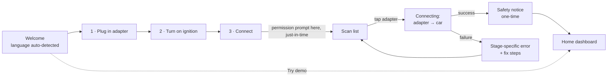
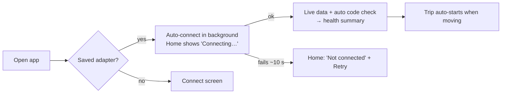
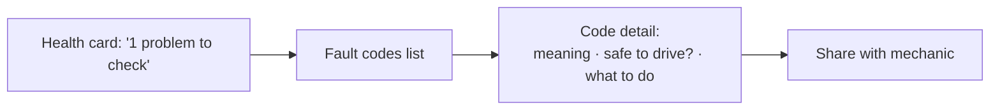
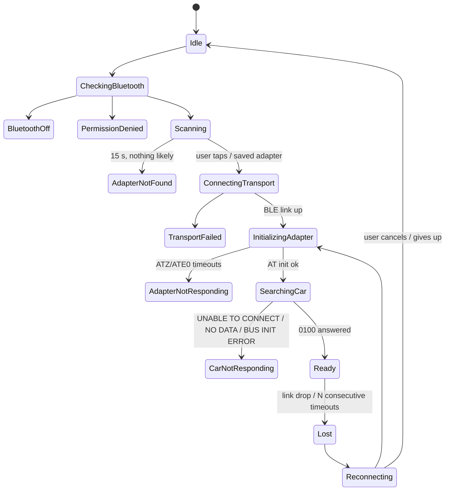
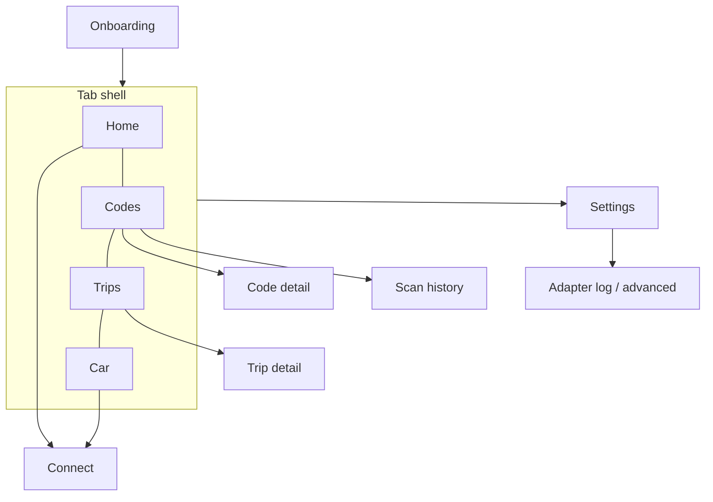
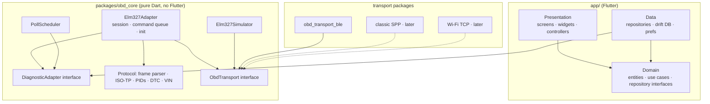

# Drivly — Product & Technical Design

> **Status:** Draft v0.1 · 2026-11-16 · "Drivly" is a working name (see [§10 Open questions](#10-open-questions))
> **License (planned):** GPL-3.0 · open-core
> **Platforms:** iOS + Android (Flutter) · **Languages:** EN · DE · AR (RTL) · FR

---

## Contents

1. [Product summary](#1-product-summary)
2. [User flows](#2-user-flows)
3. [Design system](#3-design-system)
4. [Screens](#4-screens)
5. [Architecture](#5-architecture)
6. [How we meet the non-functional requirements](#6-how-we-meet-the-non-functional-requirements)
7. [Testing strategy](#7-testing-strategy)
8. [Development plan](#8-development-plan)
9. [Open-source setup](#9-open-source-setup)
10. [Open questions](#10-open-questions)
11. [Decisions log (calls made in this draft)](#11-decisions-log)

---

## 1. Product summary

### What it is

Drivly is a free, open-source app that turns a cheap Bluetooth OBD2 adapter into a calm,
readable window into your car. You plug the adapter in, connect, and see live engine data and
any fault codes, explained in plain language. You don't need an account, there's no cloud, and
no data leaves the phone.

### Who it's for

People who drive but aren't mechanics. They have three common moments:

| Moment | What they want | What Drivly gives them |
|---|---|---|
| "The engine light just came on." | Is this serious? Can I keep driving? | A severity rating, a plain-language explanation, and what to do next |
| "Something feels off." | A quick check | A health summary at the top of Home, with live values |
| "Going to the garage / buying a used car." | Facts to show the mechanic | Code list, VIN, and scan history to share |

### Product principles

1. **Plain words first, technical second.** Titles say "Engine temperature" and the subtitle says "Coolant · PID 05".
2. **Glanceable.** You can read a number in under a second. Values are large, there's little text, and the touch targets are big.
3. **Never lie, never crash.** If we don't know a value, we say so and don't show a guess. Bad adapter data is thrown away and never reaches the screen.
4. **Private by default.** Everything stays on the phone. There are no analytics SDKs, no crash-reporting SDKs and no runtime font downloads.
5. **Safe.** The app is for passengers or parked use. It **only reads** from the car and never changes anything in it ([ADR-0002](adr/0002-read-only.md)).

### Goals (v1.0)

- Connect to an ELM327-compatible **Bluetooth LE** adapter reliably, including cheap clones.
- Show live data for the 8 core values the car supports.
- Read and explain fault codes (read-only: no clearing, see [ADR-0002](adr/0002-read-only.md)).
- Read the VIN and decode the make and likely year offline.
- Log trips automatically.
- Ship in 4 languages with full RTL, plus a demo mode that works with no car.

### Non-goals (v1.0)

- Classic Bluetooth (SPP) and Wi-Fi adapters. The architecture is ready for them but they aren't built.
- CSV export, health score, multiple-car management UI, cloud sync. These are premium ideas: the design leaves room for them, but they aren't built.
- ~~Charts~~: **now in v1** (2026-11-16 decision). Every reading is saved and charted over time (see §11).
- Manufacturer-specific diagnostics (ABS/airbag modules, service resets, comfort functions).
- Accounts, backend, analytics.

### Anti-goals (it would be a failure even if it "works")

- Users who don't understand what they see. Jargon on a primary label counts as a bug.
- An app that encourages looking at the phone while driving.
- Any data leaving the phone without an explicit, user-initiated action (Share, Search online).
- Crashing or freezing because an adapter sent garbage.
- Free users feeling nagged. There are no locked-feature teasers in v1.0.

### Compatibility reality (to state honestly in the app and README)

- **Cars:** OBD2 is mandatory for petrol cars from **1996 (US)** and **2001 (EU)**, and for diesel cars from **2004 (EU)**. Most cars from about 2008 use CAN, which is the fastest and most reliable protocol. Electric cars often expose little or no standard OBD2 data.
- **Adapters:** iPhones can only talk to **Bluetooth LE** adapters (often labeled "Bluetooth 4.0" or "for iOS"). Many very cheap ELM327 adapters are *classic* Bluetooth (2.0). Those show up in Android's Bluetooth settings but not in Drivly v1. **Onboarding, the troubleshooting sheet and the README must say this clearly.** It will be the #1 support issue.
- **Clones:** "v1.5" clones are usually more reliable than "v2.1" clones. Expect slow replies, missing commands and occasional garbage.

---

## 2. User flows

### 2.1 First run



### 2.2 Everyday use



### 2.3 Fault code journey



### 2.4 Connection state machine

This is the single source of truth for every connection-related UI state.



Each failure state maps to exactly one user-facing error. The copy is in [§4.10](#410-global-states-catalog).
Because we know which stage failed, the error can say whether to check **the adapter** or **the car**.

---

## 3. Design system

### 3.1 Look & feel

Calm and modern. Dark mode comes first, because the app is used in a car. The graphite
background has **one accent color (electric blue)**. Green, orange and red are used **only for
status**, and they always come with an icon and a word, so the app works for color-blind users.
Cards are rounded, icons are simple line icons, and motion is smooth but subtle.

### 3.2 Color tokens (starting palette, validate contrast with a checker)

| Token | Dark (default) | Light | Use |
|---|---|---|---|
| `bg` | `#0F1115` | `#F4F5F7` | Screen background |
| `surface` | `#171A1F` | `#FFFFFF` | Cards |
| `surfaceRaised` | `#1F232A` | `#EEF0F3` | Gauge track, chips, pressed state |
| `outline` | `#2C313A` | `#D9DDE3` | Dividers, card borders |
| `textPrimary` | `#F2F4F7` | `#12151A` | Values, titles |
| `textSecondary` | `#A3AAB7` | `#5A6270` | Labels, units, subtitles |
| `accent` | `#3D9BFF` | `#0B6BDB` | Gauge arcs, primary buttons, links |
| `onAccent` | `#0F1115` | `#FFFFFF` | Text on accent |
| `good` | `#34D399` | `#128A4B` | "All good", connected |
| `warn` | `#FFA94D` | `#B95E00` | "Check soon", medium severity |
| `danger` | `#FF5A5F` | `#D92D20` | "Needs attention", high severity, destructive |

Rules:
- Status chips use a **tinted background** (status color at ~16% opacity) with status-colored icon and text.
- **Minor** severity uses neutral (`textSecondary`) and not green, because green means "good" everywhere else.
- Accent on `bg` ≈ 6.6:1 in dark mode. Target **≥ 4.5:1** for text and **≥ 3:1** for gauge arcs and icons.

### 3.3 Typography

- **System fonts** (SF Pro / Roboto, which fall back to SF Arabic / Noto Arabic automatically). This means nothing to bundle and no runtime downloads. Don't use the `google_fonts` package, because it fetches fonts at runtime and breaks the privacy promise.
- All live numbers use **tabular figures** (`FontFeature.tabularFigures()`) so digits don't jitter as values change.
- Arabic UI shows **Western digits (0–9) on gauges** for glanceability. Body text follows the locale (see [§11](#11-decisions-log)).

| Style | Size (sp) | Weight | Use |
|---|---|---|---|
| `gaugeValue` | 56 (64 in landscape) | 600 | Speed, RPM |
| `tileValue` | 32 | 600 | Metric tiles |
| `title` | 22 | 600 | Screen and section titles |
| `body` | 16 | 400 | Explanations (never below 16) |
| `label` | 14 | 500 | Units, captions, chips |
| `code` | 16, monospace | 500 | DTC codes, VIN |

### 3.4 Shape, spacing, touch

- 8-pt grid. Screen padding is 16. Card padding is 16. The gap between cards is 12.
- Card radius is 20, button radius 16, chip radius 999 (pill).
- **Minimum touch target is 56 dp** (above Material's 48), because the app is used in cars and on mounts.
- Primary buttons are full-width and 56 dp tall.

### 3.5 Motion

- Gauge values tween over 250 ms with `easeOutCubic`, retargeted on every new reading (no queueing).
- Values get light smoothing (an EMA, α≈0.5) so needles don't jitter on noisy readings.
- Respect **reduce motion** (`MediaQuery.disableAnimations`). When it's on, values jump with no tween.
- State changes (connected, health status) use a 200 ms cross-fade. There's no bouncing.

### 3.6 Accessibility

- Supports text scaling up to 200%. Metric tiles reflow from 2 columns to 1 at large scales, and gauges shrink their arc before their number.
- Screen readers: a gauge reads as "Speed, 72 kilometers per hour". Live values are **not** live regions (announcing 5 updates/s is unusable). The value is read when focused.
- Status never relies on color alone: it always has an icon and a word.
- Every icon-only button has a semantic label.

### 3.7 RTL & localization rules

- Always use `EdgeInsetsDirectional`, `AlignmentDirectional` and `start`/`end`, never `left`/`right`.
- **Do mirror:** back arrows, chevrons, list layout, progress steps.
- **Don't mirror:** circular gauges (they fill clockwise in every locale), media-like icons, the car illustration, signal-strength bars.
- **LTR islands in RTL text:** DTC codes (`P0301`), VINs and units (`km/h`) are wrapped in Unicode isolates (or a `Directionality(ltr)` widget) so the bidi algorithm doesn't scramble them.
- German strings run 30–40% longer than English. Every label must wrap or scale, with no fixed-width text boxes. Test with `de` and with text scaled to 200%.
- All user-facing text lives in ARB files from day one. That includes DTC explanations, which go in their own per-language JSON (§5.6).

### 3.8 Plain-language glossary (draft, needs native-speaker review)

| Technical | EN label | DE | FR | AR |
|---|---|---|---|---|
| Vehicle speed (0D) | Speed | Geschwindigkeit | Vitesse | السرعة |
| Engine RPM (0C) | Engine speed | Drehzahl | Régime moteur | دورات المحرك |
| Coolant temp (05) | Engine temperature | Motortemperatur | Température moteur | حرارة المحرك |
| Control module voltage / ATRV | Battery | Batterie | Batterie | البطارية |
| Calculated load (04) | Engine load | Motorlast | Charge moteur | حمل المحرك |
| Intake air temp (0F) | Intake air | Ansaugluft | Air d'admission | هواء السحب |
| Throttle position (11) | Throttle | Drosselklappe | Papillon | الخانق |
| Fuel tank level (2F) | Fuel | Tankinhalt | Carburant | الوقود |
| MIL | Engine light | Motorkontrollleuchte | Voyant moteur | لمبة المحرك |
| Stored DTC (mode 03) | Confirmed problem | Bestätigter Fehler | Problème confirmé | عطل مؤكد |
| Pending DTC (mode 07) | Developing problem | Möglicher Fehler | Problème en cours | عطل محتمل |

Each tile has an **(i)** bottom sheet with a one-sentence explanation. For example: *"Engine load: how hard the engine is working right now. High when accelerating or climbing, low when cruising."*

---

## 4. Screens

### 4.0 Navigation map

A bottom navigation bar with **4 tabs: Home · Codes · Trips · Car**. **Settings** opens from a gear
icon at the top end of every tab's app bar. Settings is not a tab, because "Einstellungen" is too
long for a nav label and users rarely need it. The Codes tab shows a badge with the code count.
Onboarding and Connect are full-screen routes outside the tab shell.



The **connection status pill** appears in the app bar of Home, Codes and Car:
`(o) Connected` (good) · `( ) Connecting…` (animated accent) · `( ) Not connected` (neutral, tap to connect) · `DEMO` (accent outline, always visible in demo mode so simulated data is never mistaken for real data).

---

### 4.1 Onboarding (3 steps)

**Purpose:** get a non-technical user from "adapter in a box" to live data in under 2 minutes.

```
┌──────────────────────────────────┐
│ EN v                    Try demo │  language picker · demo link
│                                  │
│       ┌────────────────────┐     │
│       │   line drawing:    │     │
│       │   OBD port under   │     │
│       │   the dashboard    │     │
│       └────────────────────┘     │
│                                  │
│  Plug in your adapter            │  title
│  The port is usually under the   │  max 2 lines
│  dashboard, near your knees.     │
│                                  │
│  Where is my port?  >            │  → bottom sheet with 3 common spots
│                                  │
│             ● ○ ○                │  step 1 of 3
│ ┌──────────────────────────────┐ │
│ │             Next             │ │  56 dp primary
│ └──────────────────────────────┘ │
└──────────────────────────────────┘
```

| Step | Title | Body | Extra |
|---|---|---|---|
| 0 | Welcome to Drivly | Understand your car in plain words. Everything stays on your phone. | Language picker (preselected from system) · "Get started" · "Try demo" |
| 1 | Plug in your adapter | The port is usually under the dashboard, near your knees. | "Where is my port?" sheet · "Which adapter do I need?" sheet (Bluetooth LE, iPhone note) |
| 2 | Turn on the ignition | Turn the key or press Start without your foot on the brake. Some cars need the engine running. | — |
| 3 | Connect | We'll look for your adapter. | Primary button triggers the **Bluetooth permission prompt** (just-in-time), then opens Connect |

After the first successful connection, a **one-time safety notice** appears: *"Drivly is for passengers
and parked use. Don't look at your phone while driving."* It has one button, `I understand`. It can
be re-read from Settings.

**States:** if permission is denied at step 3, show the inline permission state (§4.10). Onboarding is never shown again after it's completed or the user taps "Try demo". It can be reset from Settings → About.

---

### 4.2 Connect / adapter list

```
┌──────────────────────────────────┐
│ <  Connect adapter               │
├──────────────────────────────────┤
│ (~) Looking for adapters…        │  scanning row, 15 s then "Scan again"
│                                  │
│ LIKELY OBD ADAPTERS              │
│ ┌──────────────────────────────┐ │
│ │ [plug] OBDII            ▂▄▆  │ │  name · signal
│ │        Last used             │ │
│ └──────────────────────────────┘ │
│ ┌──────────────────────────────┐ │
│ │ [plug] IOS-Vlink        ▂▄_  │ │
│ └──────────────────────────────┘ │
│                                  │
│ OTHER BLUETOOTH DEVICES (4)   v  │  collapsed by default
│                                  │
│ Can't find your adapter?      >  │  → troubleshooting sheet
│ Try demo mode                 >  │
└──────────────────────────────────┘
```

**Behavior**
- The scan shows all BLE devices, because many clones don't advertise a service UUID. Devices whose names match `OBD|ELM|V-?LINK|VGATE|VEEPEAK|OBDLINK|KONNWEI|CAR` (case-insensitive) go in "Likely". Everything else is collapsed under "Other".
- Results are sorted by Last used first, then signal strength (RSSI).
- Tapping a device opens the **connecting sheet**, a three-stage checklist that mirrors the state machine:

```
│ Connecting to OBDII              │
│ [x] Connecting to adapter        │
│ [~] Talking to adapter           │
│ [ ] Talking to your car          │
│     This can take up to 15 s     │
│ [ Cancel ]                       │
```

- On success, a light haptic plays, the adapter is saved as **preferred**, the safety notice shows if it's the first time, and the app goes to Home.
- On failure, the sheet turns into the stage-specific error (§4.10) with "Try again" and "Choose another adapter".

**States:** Bluetooth off · permission denied · Location off (Android ≤ 11) · scanning · nothing found after 15 s (troubleshooting checklist) · connection failed · adapter not responding · car not responding.

**Troubleshooting sheet** (plain checklist):
1. Is the adapter's light on? If not, it isn't getting power. Check that it's pushed in fully.
2. Is the ignition on?
3. Is it a Bluetooth LE adapter? Classic-Bluetooth adapters don't work with iPhone, or with Drivly yet.
4. Is it connected to another phone or app? Close the other app or turn off Bluetooth on that phone.
5. Unplug the adapter for 10 seconds and plug it back in.

---

### 4.3 Home dashboard

**Purpose:** answer "is my car OK right now?" at a glance, then show live values.

Portrait:

```
┌──────────────────────────────────┐
│ Drivly           (o) Connected ⚙ │
├──────────────────────────────────┤
│ ┌──────────────────────────────┐ │
│ │ [✓] All good                 │ │  HEALTH SUMMARY (tap → Codes)
│ │ No problems · Battery 14.1 V │ │
│ └──────────────────────────────┘ │
│                                  │
│   ╭─────────╮     ╭─────────╮    │
│  ╱    72     ╲   ╱  2150     ╲   │  two arc gauges (270°)
│ │    km/h     │ │   rpm       │  │  number dominant, arc secondary
│                                  │
│ ┌──────────────┐┌──────────────┐ │
│ │Engine temp  i││Battery      i│ │
│ │ 92 °C        ││ 14.1 V       │ │
│ │ Normal       ││ Charging     │ │  plain-language status word
│ └──────────────┘└──────────────┘ │
│ ┌──────────────┐┌──────────────┐ │
│ │Engine load   ││Throttle      │ │
│ │ 23 %   ▓▓░░░ ││ 15 %   ▓░░░░ │ │  mini bar for % values
│ └──────────────┘└──────────────┘ │
│ ┌──────────────┐┌──────────────┐ │
│ │Intake air    ││Fuel          │ │
│ │ 24 °C        ││ 63 %   ▓▓▓░░ │ │
│ └──────────────┘└──────────────┘ │
│  2 values not supported by your  │  footnote → explanation sheet
│  car  >                          │
├──────────────────────────────────┤
│  Home    Codes    Trips    Car   │
└──────────────────────────────────┘
```

Landscape (car mount): gauges on the start side at 2/3 width, tiles in a scrolling column on the end side, and the health summary as a single line above the gauges.

**Health summary logic (free tier, pure function, unit-tested)**

| Status | Shown when (any) | Text example |
|---|---|---|
| Neutral `Not checked yet` | Connected but the first code check hasn't finished | "Checking your car…" |
| Green `All good` | Engine light off **and** 0 stored codes **and** temp and battery normal | "No problems · Battery 14.1 V" |
| Orange `Check soon` | Pending codes · medium/minor stored codes · battery 12.0–13.2 V while running or < 12.4 V engine off · engine temp 110–115 °C | "1 problem to check" |
| Red `Needs attention` | Engine light ON · any high-severity code · engine temp > 115 °C · battery < 12.0 V while running | "Engine light is on · 2 problems" |

Plain status words on tiles:
- **Engine temperature:** < 70 °C "Warming up" · 70–109 "Normal" · 110–115 "Hot" (warn) · > 115 "Too hot" (danger).
- **Battery:** engine running 13.2–14.8 V "Charging" · 12.0–13.2 "Low charging" (warn) · > 15.0 "Too high" (warn). Engine off: ≥ 12.4 "Good" · 12.0–12.4 "Low" (warn) · < 12.0 "Very low" (danger).
- Thresholds are approximate. They live in one config file and are labeled as general guidance in the (i) sheets.

**Behavior**
- Only **supported** values are shown, based on the 0100/0120/0140 bitmasks. Battery always shows because it comes from the adapter (`ATRV`), not the car.
- Tapping a tile opens the (i) sheet with an explanation, the normal range, and the technical name.
- The dashboard keeps the screen awake while connected (setting, on by default).
- **Safety:** while speed > 0, a slim non-dismissable strip shows at the top: *"Passenger view: don't use while driving"*.
- **Stale data:** if a value hasn't updated for more than 3 s, it dims to 40% opacity and shows "last updated 5 s ago" in its (i) sheet. Values are never silently frozen.

**States**

| State | What the user sees |
|---|---|
| Not connected (adapter saved) | Health card: "Not connected" · big **Connect** button · "Try demo" link · gauges hidden |
| Not connected (no adapter yet) | Illustration + "Connect your adapter to see live data" + **Connect adapter** |
| Connecting | Status pill animates · skeleton gauges and tiles (shimmer off when reduce-motion is on) |
| Car not responding | Error card in place of the gauges: "Your car isn't answering" + "Try again" (§4.10) |
| Connection lost | Top banner "Connection lost: reconnecting…" · values dimmed · banner turns into "Reconnected" (2 s) |
| Demo mode | `DEMO` pill, otherwise identical |

---

### 4.4 Fault codes list

```
┌──────────────────────────────────┐
│ Fault codes          (o)       ⚙ │
├──────────────────────────────────┤
│ ┌──────────────────────────────┐ │
│ │ [!] Engine light is ON       │ │  status card (danger tint)
│ │ 3 problems · checked 14:02   │ │
│ │ [        Scan again        ] │ │
│ └──────────────────────────────┘ │
│                                  │
│ CONFIRMED PROBLEMS (2)           │  mode 03
│ ┌──────────────────────────────┐ │
│ │ [HIGH] Engine misfire,       │ │
│ │        cylinder 1         >  │ │
│ │ P0301 · Get it checked today │ │
│ └──────────────────────────────┘ │
│ ┌──────────────────────────────┐ │
│ │ [MED]  Oxygen sensor slow    │ │
│ │        to respond         >  │ │
│ │ P0133 · Check soon           │ │
│ └──────────────────────────────┘ │
│                                  │
│ DEVELOPING PROBLEMS (1)      (i) │  mode 07, (i) explains "pending"
│ ┌──────────────────────────────┐ │
│ │ [MINOR] Evap system small    │ │
│ │         leak              >  │ │
│ │ P0442 · Not urgent           │ │
│ └──────────────────────────────┘ │
│                                  │
│  Scan history  >                 │
└──────────────────────────────────┘
```

**Behavior**
- Codes are **scanned automatically on connect** with `0101` (engine light + count), then `03` and `07`. "Scan again" repeats the scan.
- Within each group, codes are sorted by severity (high → minor), then by code.
- Each card shows a severity chip (icon + word + color), a plain-language title, the code in monospace, and a 2–4 word action.
- A code missing from the database falls back to a **category description** worked out from its structure (for example `P03xx` → "Ignition or misfire problem"), and a manufacturer code (`P1xxx`) shows "Manufacturer-specific code" with "Search online".
- Every scan is saved locally to **Scan history** (timestamp, engine light, codes).

**States**

| State | Content |
|---|---|
| Never scanned, not connected | "Connect to check your car for problems" + Connect |
| Scanning | Skeleton cards + "Asking your car…" |
| No codes | Big check icon · "No problems found" · "Your car didn't report any fault codes. Checked 14:02." |
| Engine light on, but 0 codes returned | Orange card: "Your engine light is on, but your car didn't share a code. Some problems are only visible with a manufacturer tool." |
| Read failed | "Couldn't read codes" + reason (car not responding / adapter busy) + Try again |

### 4.5 Fault code detail

```
┌──────────────────────────────────┐
│ <                        [share] │
├──────────────────────────────────┤
│ P0301                            │  code, monospace, LTR-isolated
│ Engine misfire in cylinder 1     │
│ ┌──────────────────────────────┐ │
│ │ [!] HIGH: get it checked     │ │  severity banner
│ │     today. Drive gently.     │ │
│ └──────────────────────────────┘ │
│ What it means                    │
│ One cylinder isn't burning fuel  │
│ properly, so the engine runs     │
│ unevenly.                        │
│ What you might notice            │
│ • Shaking at idle                │
│ • Less power when accelerating   │
│ Is it safe to drive?             │
│ Short trips, gently. If the      │
│ engine light flashes, stop.      │
│ Common causes                    │
│ 1. Worn spark plug               │
│ 2. Faulty ignition coil          │
│ What to do                       │
│ Book a garage visit soon.        │
│                                  │
│ For your mechanic             v  │  technical title · confirmed/pending · ECU
│ [        Search online         ] │  opens browser (user-initiated)
└──────────────────────────────────┘
```

**Share** sends a plain-text summary through the share sheet (codes, titles, date, plus make and year if known; the VIN only if the user ticks "include VIN").

### 4.6 Clear codes flow (removed)

**Removed on 2026-11-17: Drivly is read-only toward the car ([ADR-0002](adr/0002-read-only.md)).** The original flow is kept below for reference only.

1. **Precondition:** if speed > 0, the button is disabled with the caption *"Stop the car first"*.
2. Tapping it opens a bottom sheet:

```
│ Clear 3 fault codes?             │
│ (i) This turns the engine light  │
│     off but doesn't fix          │
│     anything. If the problem is  │
│     still there, the codes will  │
│     come back.                   │
│ (i) Your car's inspection checks │
│     reset. It may fail an        │
│     emissions test (TÜV/AU, MOT, │
│     contrôle technique) until    │
│     you've driven for a few days.│
│ (i) Engine off, ignition on.     │
│                                  │
│ A copy of these codes is saved   │
│ to your scan history.            │
│ [         Clear codes          ] │  danger filled
│ [            Cancel            ] │
```

3. Before sending: save a "before clear" snapshot to history. Then send `04`, wait for `44`, and **re-scan automatically**.
4. Result: either "Codes cleared. No problems right now." or *"1 code came back straight away: the problem is still there."*

### 4.7 Vehicle info ("Car" tab)

```
┌──────────────────────────────────┐
│ My car               (o)       ⚙ │
├──────────────────────────────────┤
│         [ generic car icon ]     │  no brand logos (trademarks)
│   Volkswagen · 2016 (likely)     │
│   Golf                    [edit] │  user-entered model / nickname
│ ┌──────────────────────────────┐ │
│ │ VIN  WVWZZZAUZGW123456 [copy]│ │
│ │ Made in            Germany   │ │
│ │ Connection    CAN (modern)   │ │
│ │ Values available        14   │ │
│ │ Distance since codes        │ │
│ │ were cleared       1,240 km  │ │  PID 31, if supported
│ └──────────────────────────────┘ │
│ ADAPTER                          │
│ ┌──────────────────────────────┐ │
│ │ OBDII · ELM327 v1.5          │ │
│ │ Battery at port     12.6 V   │ │
│ │ Change adapter            >  │ │
│ └──────────────────────────────┘ │
└──────────────────────────────────┘
```

**Behavior**
- The VIN is read once per connection (`0902`) and cached per vehicle.
- **Make and country** are decoded offline from the WMI (first 3 characters), using a bundled table built from NHTSA vPIC public-domain data.
- **Year** comes from VIN position 10. It's shown as "(likely)" because it's ambiguous every 30 years and not mandatory in the EU. Tapping it lets the user correct it.
- **The model can't be decoded reliably offline.** The user types it (optional). An online lookup would send the VIN off the phone, so it's out for v1 (possible later as an opt-in).

**States:** VIN not supported (common on older EU cars) → *"Your car doesn't share its VIN over OBD. You'll find it on your registration document or at the bottom of the windshield."* + **Enter VIN** (17 characters, no I/O/Q; check digit is not enforced because EU VINs don't use it) · not connected → shows cached info with "Last read 3 days ago" · never connected → empty state + Connect.

### 4.8 Trips list & trip detail

```
┌──────────────────────────────────┐
│ Trips                          ⚙ │
├──────────────────────────────────┤
│ ┌──────────────────────────────┐ │
│ │ (●) Recording · 12 min       │ │  active trip card
│ │     8.2 km           [ Stop ]│ │
│ └──────────────────────────────┘ │
│ THIS WEEK · 5 trips · 87 km      │
│ TODAY                            │
│ ┌──────────────────────────────┐ │
│ │ 08:12 – 08:41        24.3 km │ │
│ │ 29 min · avg 50 km/h       > │ │
│ └──────────────────────────────┘ │
│ YESTERDAY                        │
│ ┌──────────────────────────────┐ │
│ │ 17:40 – 18:02        11.0 km │ │
│ └──────────────────────────────┘ │
└──────────────────────────────────┘
```

**Trip detail:** date header · 2×3 stat grid (Duration · Distance · Avg speed · Max speed · Max engine temp · Idle time) · start/end time · note "Distance is calculated from your car's speed and may differ slightly from your odometer" · **Delete trip**. Space is reserved for a future chart, but nothing is shown there in v1.

**Recording rules**
- **Auto-start:** connected, and speed > 5 km/h for 5 s.
- **Auto-stop:** speed 0 **and** RPM 0 for 60 s, or adapter disconnected/car silent for 2 min. Manual Stop always works.
- Trips under 0.2 km or under 1 min are discarded.
- Distance is the trapezoidal integral of speed. Gaps over 10 s aren't integrated and are flagged as a data gap.
- v1 records **only while Drivly is in the foreground** (screen kept awake). See [§10 Q4](#10-open-questions).

**States:** empty → *"No trips yet. Trips are recorded automatically while you're connected and driving."* · auto-record off → empty state links to the setting.

### 4.9 Settings

```
GENERAL
  Language ............ System / English / Deutsch / العربية / Français
  Units: speed ........ km/h | mph      (distance follows: km | mi)
  Units: temperature .. °C | °F
  Theme ............... Dark (default) | Light | System
  Keep screen on ...... [on]  (while connected)
ADAPTER
  Saved adapter ....... OBDII · Forget
  Connect automatically [on]
  Advanced  >           protocol (Auto), adapter log (view / share)
TRIPS
  Record trips automatically [on]
  Delete all trips
DEMO
  Demo mode ........... [off]  "Simulated data, no car needed"
SAFETY & PRIVACY
  Safety notice  >
  Privacy: "Everything stays on this phone. No account, no tracking."
ABOUT
  Version · Source code · Open-source licenses · Help translate · Report a problem
  Show onboarding again
```

- All values are stored in **SI units** (km/h, °C, km, V) and converted only when displayed.
- The **Adapter log** keeps the last ~500 raw TX/RX lines in memory and on disk. Sharing redacts the VIN by default. This is the main tool for bug reports from users with odd clones.
- "Report a problem" opens a prefilled GitHub issue in the browser (user-initiated).

### 4.10 Global states catalog

Each error follows the same pattern: what happened, what to do, and one primary action.

| State | Title | Body | Primary | Secondary |
|---|---|---|---|---|
| Bluetooth off | Bluetooth is off | Turn on Bluetooth to connect to your adapter. | Android: **Turn on** · iOS: **Open Settings** | Try demo |
| Permission denied (can ask) | Drivly needs Bluetooth access | It's only used to talk to your adapter. Nothing leaves your phone. | **Allow** | — |
| Permission denied (permanent) | Bluetooth access is off | Turn on Bluetooth access for Drivly in Settings. | **Open Settings** | — |
| Location off (Android ≤ 11) | Turn on Location | Older Android versions need Location on to find Bluetooth devices. Drivly never uses your location. | **Open Settings** | — |
| No adapter found | No adapter found | Troubleshooting checklist (§4.2) | **Scan again** | Try demo |
| Transport failed | Couldn't connect to OBDII | It may be connected to another phone or app. | **Try again** | Choose another |
| Adapter not responding | The adapter isn't answering | Unplug it, wait 10 seconds, plug it back in. | **Try again** | Adapter log |
| Car not responding | Your car isn't answering | Turn the ignition on, or start the engine, and try again. | **Try again** | Learn more |
| Connection lost | Connection lost: reconnecting… | (banner, values dimmed) | — | Stop |
| Value unsupported | (tile hidden) | Footnote "N values not supported by your car" | — | — |
| Generic unexpected | Something went wrong | Try again. If it keeps happening, share the adapter log with us. | **Try again** | Share log |

Shared widgets: `EmptyState`, `ErrorState`, `LoadingSkeleton`, `StatusBanner`, `StatusPill`. They're built once, used everywhere, and golden-tested in light/dark × LTR/RTL.

---

## 5. Architecture

### 5.1 Layers



**Two extension seams**
1. **`ObdTransport`** (bytes in, bytes out). Any adapter that speaks the ELM327 command set plugs in here: BLE, classic Bluetooth, Wi-Fi ELM327 (TCP `192.168.0.10:35000`), and an ESP32 or Raspberry Pi running ELM327-compatible firmware.
2. **`DiagnosticAdapter`** (semantic: read a PID, read DTCs, read the VIN). A custom adapter with its own protocol (for example ESP32 firmware speaking JSON) implements this directly and skips ELM327 entirely.

**Dependency rule:** `obd_core` imports nothing from Flutter or the app. The app depends only on the interfaces. Concrete adapters are created by an `AdapterFactory` chosen at runtime (BLE vs demo).

### 5.2 Folder structure

```
drivly/
├── LICENSE                          # GPL-3.0 full text
├── README.md                        # what · screenshots · compatible adapters · build · privacy
├── CONTRIBUTING.md                  # setup, tests, style, DCO/CLA, how to add a PID / DTC / translation
├── CODE_OF_CONDUCT.md
├── PRIVACY.md                       # "no data leaves the phone", in plain words
├── SECURITY.md
├── pubspec.yaml                     # Dart pub workspace root
├── analysis_options.yaml            # strict lints shared by all packages
├── .github/
│   ├── workflows/ci.yml             # format · analyze · test · license check on every PR
│   ├── ISSUE_TEMPLATE/              # bug · adapter compatibility report · translation · DTC text
│   └── pull_request_template.md
├── docs/
│   ├── DESIGN.md                    # this file
│   ├── adapters.md                  # tested adapters + results
│   ├── protocol-notes.md            # ELM327 quirks we've met
│   └── adr/                         # architecture decision records (0001-ble-library.md …)
├── packages/
│   ├── obd_core/                    # PURE DART: the heart, most tests live here
│   │   ├── lib/obd_core.dart
│   │   ├── lib/src/
│   │   │   ├── transport/           # obd_transport.dart, transport_state.dart, fake_transport.dart
│   │   │   ├── elm327/              # elm327_adapter.dart, elm_session.dart, command_queue.dart,
│   │   │   │                        # response_framer.dart, sanitizer.dart, elm_error.dart, init_sequence.dart
│   │   │   ├── protocol/            # frame_parser.dart (headers: CAN 11/29-bit, legacy), iso_tp.dart
│   │   │   ├── pids/                # pid.dart, pid_registry.dart, decoders.dart, supported_pids.dart
│   │   │   ├── dtc/                 # dtc.dart, dtc_decoder.dart, monitor_status.dart (PID 01)
│   │   │   ├── vin/                 # vin.dart, vin_parser.dart, wmi_lookup.dart, model_year.dart
│   │   │   ├── polling/             # poll_scheduler.dart, poll_plan.dart
│   │   │   ├── adapter/             # diagnostic_adapter.dart, obd_result.dart, adapter_info.dart
│   │   │   └── simulator/           # elm327_simulator.dart, simulated_car.dart (demo + tests)
│   │   └── test/
│   │       ├── fixtures/transcripts/   # real adapter logs, e.g. vgate_v15_golf7_can11.txt
│   │       └── …mirrors src/
│   ├── obd_transport_ble/           # Flutter package: BLE ObdTransport impl
│   └── dtc_database/                # assets/{base,en,de,fr,ar}.json + loader + validation tests
└── app/                             # the Flutter application
    ├── pubspec.yaml
    ├── l10n.yaml
    ├── assets/                      # illustrations (SVG), wmi.json
    ├── lib/
    │   ├── main.dart
    │   ├── app/                     # app.dart, router.dart, providers.dart (DI root)
    │   │   └── theme/               # tokens.dart, app_theme.dart, typography.dart
    │   ├── core/                    # result types, logging (adapter log), units, formatters,
    │   │                            # entitlements.dart (premium seam), safety.dart
    │   ├── l10n/                    # app_en.arb, app_de.arb, app_ar.arb, app_fr.arb
    │   ├── data/                    # db/ (drift: database.dart, tables/, daos/), preferences/
    │   ├── shared/widgets/          # status_pill, empty_state, error_state, skeleton, arc_gauge, metric_tile
    │   └── features/
    │       ├── onboarding/          # presentation/
    │       ├── connection/          # domain/ (connection_state.dart) · data/ (adapter_repository) ·
    │       │                        # presentation/ (connect_screen, connecting_sheet, controller)
    │       ├── dashboard/           # domain/ (health_summary.dart: pure fn) · presentation/
    │       ├── fault_codes/         # domain/ · data/ (scan_history_repo) · presentation/
    │       ├── vehicle/             # domain/ · data/ · presentation/
    │       ├── trips/               # domain/ (trip_recorder.dart) · data/ (trips_repo) · presentation/
    │       └── settings/            # presentation/
    ├── test/                        # unit + widget + golden tests
    └── integration_test/            # full flows against the simulator
```

Rule of thumb: **don't create a layer folder until it has a file.** A small feature can be `presentation/` only.

### 5.3 Key interfaces (sketch)

```dart
// packages/obd_core/lib/src/transport/obd_transport.dart
enum TransportKind { ble, classic, wifi, simulated }

abstract interface class ObdTransport {
  TransportKind get kind;
  Stream<TransportState> get state;        // disconnected, connecting, connected, failed(reason)
  Stream<List<int>> get incoming;          // raw bytes, any chunking
  Future<void> connect({Duration timeout = const Duration(seconds: 10)});
  Future<void> write(List<int> bytes);
  Future<void> disconnect();
}

// packages/obd_core/lib/src/adapter/obd_result.dart
sealed class ObdResult<T> {}
final class Ok<T> extends ObdResult<T> { Ok(this.value); final T value; }
final class NoData<T> extends ObdResult<T> {}               // "NO DATA"
final class NotSupported<T> extends ObdResult<T> {}         // PID not in bitmask, "?"
final class CarNotResponding<T> extends ObdResult<T> {}     // UNABLE TO CONNECT, BUS INIT ERROR
final class AdapterError<T> extends ObdResult<T> { AdapterError(this.kind, this.raw); final ElmError kind; final String raw; }
final class TimedOut<T> extends ObdResult<T> {}
final class Malformed<T> extends ObdResult<T> { Malformed(this.raw); final String raw; }

// packages/obd_core/lib/src/adapter/diagnostic_adapter.dart
abstract interface class DiagnosticAdapter {
  Stream<AdapterStatus> get status;
  Future<ObdResult<AdapterInfo>> initialize();             // ELM: ATZ … 0100
  Future<ObdResult<Set<int>>> supportedPids();             // mode 01 bitmasks, ORed over ECUs
  Future<ObdResult<PidValue>> readPid(Pid pid);
  Future<ObdResult<MonitorStatus>> readMonitorStatus();    // 0101: engine light + count
  Future<ObdResult<List<Dtc>>> readDtcs(DtcKind kind);     // stored (03) / pending (07)
  Future<ObdResult<String>> readVin();                     // 0902
  Future<ObdResult<double>> readBatteryVoltage();          // ATRV
  Future<void> close();
}
```

**Contract: no method throws for protocol or data problems.** Every failure is an `ObdResult`.
Only programmer errors (asserts) may throw. The UI switches exhaustively over the sealed type.

### 5.4 ELM327 protocol design

**Framing.** One command is in flight at a time, through a FIFO `CommandQueue`. Each command is written
as ASCII + `\r`. Incoming bytes are buffered until the prompt `>`. Notifications can split a reply
anywhere, so we never assume one notification equals one reply.

**Sanitizing (before any parsing)**
- Drop `\0` bytes (some clones send them), `>`, and whitespace. Uppercase everything.
- Drop the echo line if it equals the command (ATE0 is sometimes ignored).
- Drop `SEARCHING...` and `BUS INIT: ...OK`.
- Accept both spaced and unspaced hex (ATS0 is sometimes ignored).
- Accept both header and no-header lines (ATH1 is sometimes ignored).

**Error classification** (`ElmError`):

| Raw | Meaning | Mapped to |
|---|---|---|
| `NO DATA` | ECU didn't answer this request | `NoData` (PID treated as unsupported after 3 in a row) |
| `UNABLE TO CONNECT`, `BUS INIT: ERROR`, `CAN ERROR` | No protocol / car off | `CarNotResponding` |
| `BUFFER FULL` | Adapter overrun (slow BLE drain) | `AdapterError` → back off polling 50%, retry once |
| `?` | Command not understood | `NotSupported` (e.g. clone lacks the command) |
| `STOPPED` | A new byte interrupted the request | Retry once (we sent too early) |
| `BUS BUSY`, `FB ERROR`, `DATA ERROR`, `<RX ERROR` | Bus or line problems | `AdapterError`, retry once |
| `LV RESET`, `ELM327 v…` mid-session | Adapter rebooted (voltage dip) | Re-run init sequence |
| no `>` before timeout | Hung or lost | `TimedOut` → send `\r`, flush until `>`, continue |

**Stale replies.** After a timeout, a late reply can arrive and be mistaken for the next command's reply.
To prevent this: after a timeout, flush until `>`. Every reply is then validated: the mode byte must be
`0x40 + mode` and the PID must match the request. Anything else is discarded and logged.

**Init sequence** (each step has its own timeout and fallback):

| # | Command | Timeout | Purpose / fallback |
|---|---|---|---|
| 1 | `ATZ` | 2.5 s | Reset; read version string. Fallback `ATWS` (warm start), then `ATD` |
| 2 | `ATE0` | 1 s | Echo off |
| 3 | `ATL0` | 1 s | Linefeeds off |
| 4 | `ATS0` | 1 s | Spaces off (fewer bytes over BLE) |
| 5 | `ATH1` | 1 s | **Headers on**: lets us tell ECUs apart and reassemble multi-frame replies ourselves |
| 6 | `ATAT1` | 1 s | Adaptive timing (ignore `?`) |
| 7 | `ATSP0` | 1 s | Automatic protocol search |
| 8 | `0100` | **15 s** | First request triggers the protocol search (`SEARCHING...`). Failure means car not responding |
| 9 | `ATDPN` | 1 s | Which protocol was found, shown as "CAN (modern)" / "K-Line (older)" |
| 10 | `0120`, `0140` | 3 s | Remaining supported-PID bitmasks (only if the previous bitmask's last bit is set) |
| 11 | `ATRV` | 1 s | Battery voltage |
| 12 | `010C1` vs `010C` | 1 s | **Response-count probe.** If the `…1` suffix works, use it: the adapter returns after the first reply instead of waiting out its timeout, which is often 2–3× faster. Disable on clones that misbehave |

**Reply parsing (with headers).** CAN 11-bit, for example `7E8 04 41 0C 1A F8`, gives
`ecu=7E8, PCI=04 (single frame, 4 bytes), payload=41 0C 1A F8`. Multi-frame replies (`10 14 …` / `21 …` / `22 …`)
are reassembled per ECU by `IsoTpAssembler`. CAN 29-bit (`18DAF110`) is supported the same way. Legacy
protocols (ISO 9141, KWP2000, J1850) have 3-byte headers and a trailing checksum. They come in the
Phase 9 hardening step unless your test car needs them sooner (see [§10 Q5](#10-open-questions)).

### 5.5 PIDs, decoding, polling

| PID | Label | Formula (A,B = data bytes) | Range check | Poll tier |
|---|---|---|---|---|
| `0C` | Engine speed | (256A + B) / 4 rpm | 0–16 383 | fast |
| `0D` | Speed | A km/h | 0–255 | fast |
| `04` | Engine load | A × 100 / 255 % | 0–100 | medium |
| `11` | Throttle | A × 100 / 255 % | 0–100 | medium |
| `05` | Engine temperature | A − 40 °C | −40–215 | slow |
| `0F` | Intake air | A − 40 °C | −40–215 | slow |
| `2F` | Fuel | A × 100 / 255 % | 0–100 | slow |
| `ATRV` / `42` | Battery | "12.6V" parsed · or (256A + B)/1000 V | 0–20 | slow |
| `01` | Engine light + code count | MIL = A bit 7 · count = A & 0x7F | — | on connect, then every 30 s |
| `31` | Distance since codes cleared | 256A + B km | — | on Car tab open |

**Supported PIDs:** in `41 00 BE 1F B8 10`, the 32 bits of `BE1FB810` map MSB → PID 01 … LSB → PID 20,
and the LSB set means "ask `0120` next". Masks from multiple ECUs are ORed together.

**DTC decoding:** for each 2-byte code, the top 2 bits give the letter (`00`=P, `01`=C, `10`=B, `11`=U), the next 2 bits the first digit,
and the remaining 12 bits three hex digits. So `01 33` → `P0133` and `C1 23` → `U0123`. `00 00` is padding and is skipped.
On CAN the byte after `43`/`47` is the code count. On legacy protocols it isn't.

**VIN:** the `0902` payload `49 02 01` + 17 ASCII bytes. Strip non-alphanumerics, take the last 17 characters, validate
(no I/O/Q). Model year: position 10 maps letters A–Y (no I, O, Q, U, Z) and digits 1–9 onto a 30-year cycle,
for example A=2010, Y=2000 or 2030, 1=2001. Pick the most recent year that is ≥ 1996 and ≤ the current year + 1. For North-American
WMIs, use position 7 to disambiguate. Otherwise mark it "likely".

**PollScheduler** (target total ~5–10 requests/s, adapting to the adapter):
- It's a weighted round-robin, for example `[RPM, SPEED, LOAD, RPM, SPEED, THROTTLE, RPM, SPEED, <next slow PID>]`. At 8 req/s, RPM and speed update about 2.7×/s, load and throttle about 0.9×/s, and each slow value every ~4 s.
- **It polls only what's needed.** Dashboard visible: the full plan. Dashboard hidden but a trip is recording: speed + RPM + engine temp. Neither: only `0101` every 30 s. App in background: paused (v1).
- **It adapts.** It tracks a moving average of latency and backs off on `BUFFER FULL` or timeouts. After 3 consecutive `NO DATA` replies, it drops a PID from the plan for this session.
- Each reading is published on a `Stream<PidReading>` with a timestamp. The UI and the trip recorder both subscribe.

### 5.6 DTC database (`packages/dtc_database`)

- `base.json` holds code → `{severity, category}` overrides. `{en,de,fr,ar}.json` hold code → `{title, meaning, symptoms[], safeToDrive, causes[], action, technicalTitle}`.
- **Fallback chain:** code in the user's language → code in English → category description worked out from the code's structure (for example `P01xx`/`P02xx` fuel & air · `P03xx` ignition/misfire · `P04xx` emissions · `P05xx` speed/idle · `P06xx` computer · `P07xx–P09xx` transmission · `Bxxxx` body · `Cxxxx` chassis · `Uxxxx` network) → "Manufacturer-specific code".
- **Severity** comes from category defaults plus per-code overrides. High is reserved for issues that can damage the engine or affect safety (misfires, overheating, oil pressure, brakes).
- **v1 content target:** the ~200 most common generic codes, hand-written in plain English, then translated. Everything else gets the category fallback.
- **Licensing:** write our own explanations. Don't copy text from commercial DTC sites. Every entry is a contributor PR, validated by a schema test in CI. This is a great "first contribution" path.

### 5.7 State management, storage, packages

| Concern | Choice | Why |
|---|---|---|
| State / DI | **Riverpod** (no codegen at first) | Testable, works naturally with streams, no `BuildContext` in logic |
| Navigation | **go_router** | Declarative, shell routes for tabs, deep-linkable later |
| Database | **drift** (SQLite) | Typed queries, migrations, good for trip samples and future export |
| Settings | **shared_preferences** | Small key-value data |
| L10n | `flutter_localizations` + `intl` (gen-l10n, ARB) | Standard, and works with Weblate/Crowdin for community translations |
| Permissions | `permission_handler` | Android 12+ `BLUETOOTH_SCAN` (`neverForLocation`) + `BLUETOOTH_CONNECT`. Android ≤ 11 location. iOS `NSBluetoothAlwaysUsageDescription` |
| Keep awake | `wakelock_plus` | Dashboard while connected |
| Share / links | `share_plus`, `url_launcher` | Only on user action |
| BLE | **To be decided**: see [§10 Q2](#10-open-questions) | flutter_blue_plus has changed license |
| Tests | `test`, `flutter_test`, `mocktail` | — |

Every dependency must be GPL-3.0-compatible (MIT, BSD or Apache-2.0 are fine). CI runs a license check.

**Data model (drift).** IDs are UUIDs and rows have `createdAt`/`updatedAt`, so sync is possible later.

| Table | Key fields |
|---|---|
| `vehicles` | id, vin?, nickname?, make?, modelYear?, modelUser?, protocol?, supportedPids (blob) |
| `adapters` | id, remoteId, name, transport, elmVersion?, lastConnectedAt, preferred |
| `dtc_scans` | id, vehicleId, at, milOn, reason (`auto`, `manual`; `beforeClear`/`afterClear` only in old history) |
| `dtc_entries` | scanId, code, kind (`stored`/`pending`), ecu? |
| `trips` | id, vehicleId, startedAt, endedAt, distanceKm, maxSpeed, avgSpeed, maxCoolant, idleSeconds |
| `trip_samples` | tripId, t, speed, rpm, coolant, load, throttle (**1 Hz**, so premium charts and export will work on past trips) |

Everything is keyed by `vehicleId` from day one, even though the v1 UI shows one car.

### 5.8 BLE transport details

- **Finding the right characteristics:** first try a table of known UUIDs (commonly `FFF0`/`FFF1` notify/`FFF2` write, `FFE0`/`FFE1` notify+write, `18F0`/`2AF0`/`2AF1`; verify these against your adapters and record results in `docs/adapters.md`). Otherwise discover services and pick the first service that has one notify/indicate characteristic and one write/write-without-response characteristic.
- Prefer **write-without-response** when it's available (faster). ELM commands are well under 20 bytes, so no MTU work is needed.
- **Remember the adapter:** store `remoteId` (a MAC on Android, a per-phone UUID on iOS) plus the name.
- **Auto-reconnect:** on launch, connect directly to the saved `remoteId` without scanning (10 s timeout). If the link drops mid-session, retry at 1 s, 2 s, 5 s, 10 s, then every 15 s while the app is in the foreground, and show the banner. Re-run the init sequence after every reconnect.

### 5.9 Demo mode

`Elm327Simulator` implements `ObdTransport` and **speaks real ELM327**. It answers AT commands and
OBD requests from a `SimulatedCar`: a small physics loop for a drive cycle (idle → accelerate → cruise →
brake), warm-up curve for temperature, slowly draining fuel, and 2 sample DTCs. Because it sits at the transport
level, demo mode exercises the **whole real stack** (queue, parser, scheduler, UI). The same simulator powers
widget tests, integration tests and screenshots. It can also inject faults (delays, `NO DATA`, garbage bytes,
disconnects) for resilience tests.

### 5.10 Designing for premium (not built in v1)

| Future feature | v1 hook |
|---|---|
| Charts & CSV export | `trip_samples` at 1 Hz · `PidReading` stream with timestamps · SI units in storage |
| Health score & maintenance | `HealthSummary` is already a pure function over typed inputs · scan history kept |
| Fuel consumption | PID registry is data-driven, so add `5E` (fuel rate) and `10` (MAF) entries |
| Multiple cars & sync | `vehicleId` everywhere · UUIDs · `updatedAt` columns |
| Brand-specific features | ELM layer supports `ATSH` (set header) and raw UDS requests through a `sendRaw()` escape hatch, kept internal for now. Write actions will need a safety gate (parked, engine off, explicit confirmation) |
| Unlocking | `Entitlements` interface in `core/`. The free build ships `FreeEntitlements` (everything false). A private `drivly_pro` package supplies a store-backed implementation at build time |

---

## 6. How we meet the non-functional requirements

| Requirement | How |
|---|---|
| Never crash on bad adapter data | `ObdResult` sealed type, no throwing in `obd_core`, range checks on every decoded value, fuzz tests feeding random bytes to the framer and parser, plus a top-level `FlutterError.onError` / `runZonedGuarded` that logs locally |
| Efficient polling (~5–10/s) | Weighted scheduler, poll only what's visible, response-count suffix, adaptive backoff (§5.5) |
| Cheap clones | Lenient sanitizer, per-step init fallbacks, stale-reply validation, transcript tests from real clones, adapter log for bug reports |
| Safety | Read-only toward the car (allowlist guard, ADR-0002), one-time notice, passenger strip while moving, no interactions that require attention while moving |
| Privacy | No network permission use in v1 except user-initiated links, no analytics or crash SDKs, system fonts, store privacy labels "Data Not Collected" |
| Accessibility | §3.6, tested with TalkBack/VoiceOver and at 200% text |
| Code quality | Strict lints, CI on every PR, ≥ 90% line coverage on `obd_core`, ADRs for big decisions |

---

## 7. Testing strategy

1. **`obd_core` unit tests (written first, TDD).** Framer (split chunks, missing `>`, `\0` bytes). Sanitizer (echo, spaces, `SEARCHING...`). Error classification. Each PID decoder against known vectors. Supported-PID bitmask. DTC decode (`0133`→`P0133`, `C123`→`U0123`, padding). ISO-TP reassembly including interleaved ECUs. VIN parse + model year. Scheduler fairness.
2. **Transcript replay tests.** Real TX/RX logs from adapter + car combinations go in `test/fixtures/transcripts/`, and a `ReplayTransport` plays them back. Users can contribute these through the "adapter compatibility" issue template, which grows coverage of odd clones over time.
3. **Simulator tests.** Full init → live data → DTC flows against `Elm327Simulator`, including injected faults, plus a check that every command sent is a read.
4. **Widget and golden tests.** Shared state widgets, gauges and tiles in dark/light × LTR/RTL × 100%/200% text.
5. **Integration tests** (`integration_test/`) driving the app in demo mode.
6. **Manual hardware matrix** before each release: at least 2 BLE adapters (a cheap v1.5 clone and a quality one such as Vgate iCar Pro BLE / OBDLink CX) × at least 1 CAN car (plus 1 legacy car if available). Covers iOS and Android 11/12+.

---

## 8. Development plan

Each phase ends with a **"done when"** you can check. Phases 0–1 are the path you asked for:
**connect → init → live RPM.**

### Phase 0: Foundations
- Create the pub workspace (`app/`, `packages/obd_core`, `packages/obd_transport_ble`), shared strict lints, and CI (format, analyze, test).
- Add LICENSE, README skeleton, CONTRIBUTING, CODE_OF_CONDUCT, PRIVACY, and ADR-0001 (BLE library, after Q2 is answered).
- **Done when:** `dart test` and `flutter test` run green in CI on an empty skeleton.

### Phase 1: First live RPM (the "hello car" milestone)
1. **`obd_core` (TDD):** `ResponseFramer` (bytes → reply on `>`), `Sanitizer`, `ElmError` classification, `FrameParser` for CAN 11-bit with and without headers, `PidDecoder` for `0C`, and `FakeTransport` for tests.
2. **`ElmSession` + `CommandQueue`:** one command in flight, per-command timeouts, flush on timeout, init sequence steps 1–8.
3. **BLE transport:** scan, connect, characteristic discovery (known UUIDs, then heuristic), notify subscription, write.
4. **Dev screen (temporary, behind a debug flag):** scan list → tap → init log → **a big RPM number** updating in a loop, plus a raw terminal to send any command and see the reply. Keep the terminal permanently as a hidden "Adapter console" for debugging.
5. **Test on a real car** with every adapter you have. Save the transcripts as fixtures.
- **Done when:** RPM updates ≥ 3×/s on a real car. Unplugging the adapter, turning the ignition off, or killing Bluetooth produces a clear state and no crash. At least 2 transcripts are committed with replay tests passing.

### Phase 2: Robust connection + demo mode
- Connection state machine (§2.4) as a Riverpod controller.
- Permissions per platform, Bluetooth-off handling, Location (Android ≤ 11).
- Remember the preferred adapter, auto-connect on launch, reconnect with backoff, re-init after reconnect.
- `Elm327Simulator` + `SimulatedCar`, wired as the demo transport.
- **Done when:** every failure state in §4.10 can be triggered (real or simulated) and shows the right copy, and demo mode runs the whole stack with no Bluetooth.

### Phase 3: App shell & design system
- Theme tokens (dark/light), typography with tabular figures, the shared state widgets, `StatusPill`.
- go_router tab shell (Home · Codes · Trips · Car) + Settings route.
- **L10n infrastructure with all 4 ARB files and RTL from the start.** Retrofitting it later is painful.
- Units service (SI → display).
- **Done when:** golden tests pass for the shared widgets in dark/light × LTR/RTL, and switching language/units/theme updates the app live.

### Phase 4: Live dashboard
- Supported-PID discovery (`0100/0120/0140`), PID registry for the 8 values, `ATRV` battery.
- `PollScheduler` with tiers, visibility-aware plans, adaptive backoff, response-count suffix.
- `ArcGauge` and `MetricTile` widgets with smoothing, tween, reduce-motion support and stale dimming.
- Health summary (pure function + tests), safety notice, passenger strip, keep-awake.
- **Done when:** on a real car the dashboard shows only supported values at ~5–10 total updates/s with no visible jitter, unsupported values are listed in the footnote, and demo mode looks identical apart from the badge.

### Phase 5: Fault codes
- `IsoTpAssembler`, `0101` monitor status, modes `03` and `07`, DTC decoder.
- `dtc_database` package: schema, loader, fallback chain, first ~50 codes in EN (grow to ~200 + translations before 1.0).
- List, detail, share, scan history. (The clear flow was removed: ADR-0002.)
- **Done when:** codes are read correctly on a real car with a known fault (or the simulator) and every scan is kept in the history.

### Phase 6: Vehicle info
- `0902` VIN (multi-frame), WMI table asset generated from NHTSA vPIC data by a script in `tool/`, model-year logic, manual VIN entry, adapter card.
- **Done when:** the VIN is read on CAN cars, cars without VIN support show the manual-entry path, and the decoder has unit tests for ambiguous years.

### Phase 7: Trips
- `TripRecorder` (auto start/stop, trapezoidal distance, gap handling), drift tables incl. `trip_samples`, list + detail + delete.
- **Done when:** a simulated 20-minute drive produces a trip whose distance is within 1% of the simulator's truth, and a real drive matches the odometer within ~3%.

### Phase 8: Settings & onboarding
- All settings in §4.9, adapter log viewer + share (VIN redacted), onboarding steps + illustrations.
- **Done when:** a new user goes from install to live data on a real car without help, in under 2 minutes (test with 2–3 non-technical people).

### Phase 9: Hardening & release 1.0
- Legacy protocol frame parsing (ISO 9141 / KWP2000 / J1850 headers and checksums) if not done earlier.
- Fuzz tests, accessibility pass (TalkBack/VoiceOver), RTL pass, German overflow pass, 200% text pass.
- Hardware matrix run, `docs/adapters.md` published.
- DTC database ~200 codes × 4 languages (native-speaker review).
- Store listings in 4 languages, privacy labels ("Data Not Collected"), TestFlight + Play internal testing → public 1.0.
- **Done when:** a beta on at least 5 car/adapter combinations runs crash-free and all checklists pass.

---

## 9. Open-source setup

- **README:** what it does (with screenshots), the **"which adapter do I need?"** section, the supported-car note, privacy promise, build instructions, demo mode, and how to contribute.
- **CONTRIBUTING:** setup, `melos`-free workspace commands, test expectations, and three easy contribution paths: **(1) adapter transcripts, (2) DTC explanations, (3) translations**. Also the DCO/CLA requirement (see Q1).
- **Issue templates:** bug (asks for the adapter log), adapter compatibility report, translation, DTC text.
- **Translations:** ARB files work with Weblate (free for open source) for community translation.
- **Releases:** semantic versioning, `CHANGELOG.md`, tagged builds.

---

## 10. Open questions

These change what gets built. They're ordered by importance.

**Q1. License and open-core: GPL-3.0 + CLA, or something else?**
Your brief says GPL-3.0 but also "MIT/GPL license file". The two pull in different directions:
- **GPL-3.0** stops others from shipping closed forks. But selling a closed-source premium module **inside the same app** is only possible if you own the copyright on *all* the GPL code. That means outside contributors must sign a **CLA** that gives you relicensing rights. The CLA also covers the known GPL vs App Store conflict, because as sole rights-holder you can publish to the App Store yourself.
- **MPL-2.0** (file-level copyleft) allows proprietary premium files in the same app with no CLA. Changes to the open files must still be shared.
- **MIT/Apache-2.0** is the simplest, but anyone can ship a closed, paid fork of your app.
- **My recommendation:** GPL-3.0 + a lightweight CLA (e.g. via CLA Assistant), with premium features in a private package. *(Not legal advice. A short consult is worth it before accepting outside contributions.)*

**Q2. Which BLE library?** flutter_blue_plus has moved from BSD to its own license. It's free for personal, non-profit
and educational use, but **for-profit use requires a paid commercial license**, and the terms vary between packages and versions. That conflicts with
your premium plans, and probably with GPL-3.0 (which forbids added restrictions). Options:
(a) pay for an FBP commercial license once you sell; (b) pin the last BSD-licensed release or use the community
BSD fork `flutter_blue_ultra`; (c) use another BLE plugin (`flutter_reactive_ble`, `universal_ble`,
`bluetooth_low_energy`); verify each one's license and maintenance first. Because BLE sits behind `ObdTransport`,
switching later is cheap. **My recommendation:** (c) or (b), decided in ADR-0001 after a 1-day spike against your adapter.

**Q3. Is "Drivly" the final name?** There's already a US automotive-software company called Drivly (driv.ly,
car-commerce APIs). It's in the same industry, so there's a trademark and store-search risk. The name lives in one constant + ARB key, so it's
easy to change, but it's better to decide before store listings and a domain.

**Q4. Should trips record while another app (e.g. Maps) is open?** In practice most drivers have navigation in
the foreground. Supporting this needs an Android foreground service and the iOS `bluetooth-central` background
mode (polling driven by BLE notifications), plus App Store review justification. **v1 default in this
draft: foreground-only.** If background recording matters for 1.0, it moves into Phase 7 and adds roughly a phase of work.

**Q5. Which adapter(s) and car(s) will you test with?** If your main test car is older than about 2008 (non-CAN), legacy
protocol parsing moves from Phase 9 into Phase 1.

---

## 11. Decisions log

These are **calls I made in this draft**, not things you've agreed to. Change any of them.

| Area | Call |
|---|---|
| Name | "Drivly" as working name (from the project folder) |
| Navigation | 4 tabs (Home · Codes · Trips · Car), Settings behind a gear icon |
| Default theme | Dark (with Light and System options) |
| Severity colors | High = red, Medium = orange, **Minor = neutral** (green means only "good") |
| Arabic numerals | Western digits on gauges and values, locale digits elsewhere |
| Fonts | System fonts, no bundling, no runtime downloads |
| Protocol | Headers on (`ATH1`) from day one. Parser also tolerates header-less replies |
| Battery | `ATRV` (adapter-measured) as primary, `0142` as fallback |
| Codes | Auto-scanned on connect so the health summary is meaningful |
| Clearing codes | Not supported. Drivly only reads from the car (ADR-0002) |
| Vehicle | Make + likely year decoded offline. Model entered by the user, no online VIN lookup |
| Trips | Auto start/stop, foreground-only in v1, 1 Hz samples stored for future charts and export |
| Demo mode | Simulated ELM327 at transport level (whole stack runs). Permanent DEMO badge |
| Premium | No locked teasers in v1. `Entitlements` seam only |
| State/DB | Riverpod, go_router, drift |
| Repo | Dart pub workspace: `app/` + `packages/obd_core` (pure Dart). BLE transport and DTC DB live in `app/` for now |
| **History (2026-11-16)** | **Every reading is saved** (not just 1 Hz trip samples) to a `readings` table (session, sensor id, t, value). Charts aggregate in SQL: avg line + min–max band, ranges Live (in-memory, 15 min) · 1H · 24H · 7D · 30D · All |
| **All data (2026-11-16)** | On connect, Drivly polls **every supported PID it knows** (~45), plus battery (ATRV) and engine light (PID 01). It no longer polls only what's visible. A weighted fair scheduler keeps RPM and speed at ~4×/s while slow values refresh every few seconds |
| Multi-PID | On CAN, up to 6 PIDs per request (probed at init, with a single-PID fallback). Replaces the `…1` response-count probe, which isn't implemented yet |
| BLE library | `universal_ble` (BSD-3). See ADR-0001 |
| Database | `sqflite` (raw SQL, no codegen) instead of drift. Same tables plus `sessions` and `readings` |
| Demo history | The first demo connection seeds a week of simulated drives for the demo car only, so charts aren't empty |
| Tabs | Home · **History** · Codes · Car. Trips live inside History |
